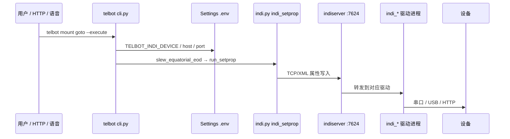
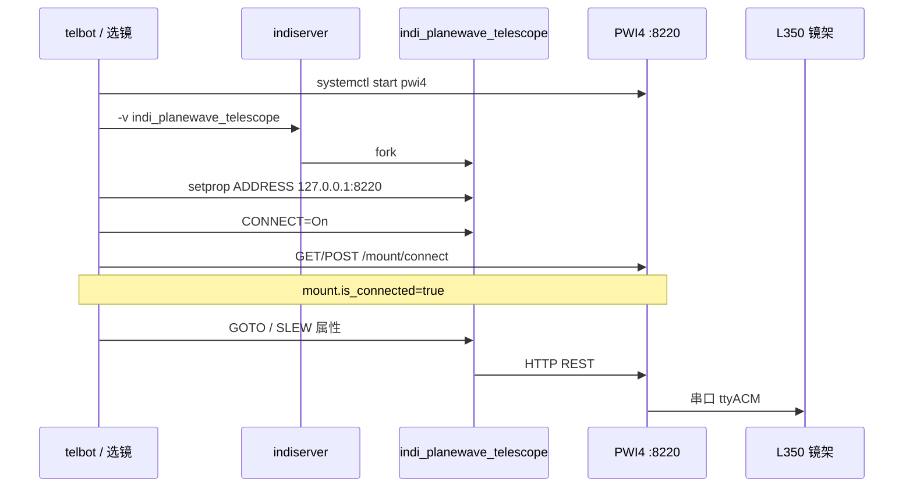

# INDI 驱动：离线恢复与 Telbot 调用链

与 [`USB_DEVICE_REGISTRY.md`](USB_DEVICE_REGISTRY.md) 中登记的 **`indi_*`** 驱动对应。离线目录与一键恢复见 [`deploy/indi-offline/README.md`](../deploy/indi-offline/README.md)。

---

## 1. 离线目录与一键恢复

| 步骤 | 命令 | 说明 |
|------|------|------|
| 下载/打包（Pi） | `bash deploy/fetch-indi-offline-debs.sh` | Debian + astroberry `.deb`、QHY 源码 tarball |
| 快照已装文件（Pi） | `sudo bash deploy/archive-indi-installed-to-offline.sh` | 生成 `installed-snapshot.tar.gz` |
| 拉到 Mac 仓库 | `rsync -av telbot:~/Telbot/deploy/indi-offline/ ~/projects/Telbot/deploy/indi-offline/` | 从 Pi **下载**到本机 `deploy/indi-offline/` |
| 一键恢复（Pi） | `sudo bash deploy/restore-indi-usb-registry-drivers.sh` | 装 Debian 栈 + 解压/安装登记表全部驱动 |
| 核对 | `bash deploy/check-usb-registry-drivers.sh` | 对照登记表 8 个 `indi_*` |

```text
deploy/indi-offline/arm64/
  debian/*.deb              # indi-bin, indi-sbig, indi-asi, libindi-dev…
  indi-bin_2.2.1_*.deb      # PlaneWave 驱动
  libindi1_2.2.1_*.deb
  indi-3rdparty-drivers_*   # Oasis
  indi-3rdparty-libs_*
  indi-3rdparty-v1.9.9.tar.gz
  installed-snapshot.tar.gz # 可选：Pi 上 /usr/local 与 indi_qhy_ccd 快照
  MANIFEST.txt
```

---

## 2. 登记表驱动 → 安装来源

| INDI 驱动 | USB 典型 | 离线目录 | 恢复方式 |
|-----------|----------|----------|----------|
| `indi_lx200gemini` | `1fc9:1705` | `debian/` | `indi-bin` deb |
| `indi_celestron_gps` | `067b:2303` | `debian/` | 同上 |
| `indi_qhycfw3_wheel` | `10c4:ea60` | `debian/` | 同上 |
| `indi_sbig_ccd` | `0d97:0101` | `debian/` | `indi-sbig` + `libsbig4t64` |
| `indi_asi_ccd` | `03c3:294f` | `debian/` | `indi-asi` |
| `indi_planewave_telescope` | `1cbe:0267` | astroberry `indi-bin` + `libindi1` | `install-indi-planewave-telescope.sh` 或 snapshot |
| `indi_oasis_focuser` | `338f:a0f0` | `indi-3rdparty-drivers/libs` | `install-indi-oasis-focuser.sh` 或 snapshot |
| `indi_qhy_ccd` | `1618:c175` | `indi-3rdparty-v1.9.9.tar.gz` | `build-indi-3rdparty-qhy-oasis.sh` 或 snapshot 内 `/usr/bin/indi_qhy_ccd` |

工具：`indiserver`、`indi_getprop`、`indi_setprop` 来自 **`indi-bin`**（`debian/`）。

PlaneWave 另需 **PWI4**（`pwi4.service`，非 INDI deb）：`deploy/telbot-pwi4-wrap.sh` → `~/pwi-4.1.8final/run-pwi4`。

---

## 3. 运行时：从 USB 插入到驱动进程

```mermaid
flowchart TB
  subgraph hw [硬件]
    USB[USB 插入 VID:PID]
  end
  subgraph udev [udev]
    RULE[99-telbot-mount.rules]
    UDEVSH[telbot-udev-select-mount.sh]
  end
  subgraph select [选镜]
    SEL[telbot-select-mount.sh]
    PY[telbot_select_mount.py]
    PROF[mount_profiles.json]
    ARGS[/run/telbot/indiserver.args]
    PWI4F[/run/telbot/pwi4_required]
  end
  subgraph systemd [systemd]
    UNIT[indi-telescope.service]
    WRAP[telbot-indiserver-wrap.sh]
    IS[indiserver :7624]
  end
  subgraph drivers [驱动进程]
    D1[indi_lx200gemini / indi_planewave_telescope / …]
    D2[optional: indi_sbig_ccd indi_qhy_ccd …]
    PWI4[PWI4 :8220 仅 PlaneWave]
  end
  USB --> RULE --> UDEVSH --> SEL
  SEL --> PY --> PROF
  PY --> ARGS
  PY --> PWI4F
  SEL --> PWI4
  SEL --> UNIT --> WRAP --> IS
  IS --> D1
  IS --> D2
  D1 --> PWI4
```

1. **udev** 根据 `lsusb` 匹配 `deploy/mount_profiles.json`，调用 `telbot-select-mount.sh`。
2. **`telbot_select_mount.py`** 选 priority 最高的 profile，写入：
   - `/run/telbot/indiserver.args`（例如 `-v indi_lx200gemini indi_sbig_ccd`）
   - `/run/telbot/mount_profile_id`、`indi_device_hint`
   - PlaneWave 时 **`pwi4_required=1`**，shell 段 **start `pwi4.service`**、等待 HTTP、**`/mount/connect`**。
3. **`indi-telescope.service`** 重启后，`telbot-indiserver-wrap.sh` 读取 args，启动 **`indiserver`**，对每个 **`-v indi_*`** **fork 驱动可执行文件**。
4. 驱动通过 **USB/串口/HID/HTTP** 访问硬件（PlaneWave：驱动 → **127.0.0.1:8220** → PWI4 → 串口）。

**auto-connect**（`mount_profiles.json` → `auto_connect_by_driver`）：restart 后对列出的设备执行 **`indi_setprop` … CONNECTION.CONNECT=On**（PlaneWave 前先设 **DEVICE_ADDRESS**）。

---

## 4. Telbot 命令 → INDI → 硬件



| Telbot 子命令 | 典型设备名 (.env) | INDI 属性（示例） | 驱动 |
|---------------|-------------------|-------------------|------|
| `telbot mount *` | `TELBOT_INDI_DEVICE` | `EQUATORIAL_EOD_COORD`、`TELESCOPE_SLEW` | 赤道仪 `indi_*` |
| `telbot camera *` | `TELBOT_INDI_CCD_DEVICE` | `CCD_EXPOSURE`、`UPLOAD_MODE` | `indi_sbig_ccd` / `indi_asi_ccd` / `indi_qhy_ccd` |
| `telbot focuser *` | `TELBOT_INDI_FOCUSER_DEVICE` | `ABS_FOCUS_POSITION` | `indi_oasis_focuser` |
| `telbot filter *` | `TELBOT_INDI_CFW_DEVICE` | `FILTER_SLOT` | `indi_qhycfw3_wheel` |
| `telbot preflight` | 上述 + 服务状态 | `*.*.*` getprop | 全部已加载驱动 |

实现要点：

- **`src/telbot/indi.py`**：`run_setprop` / `run_getprop` 调用系统 **`indi_setprop`**、**`indi_getprop`**（与 `indiserver` 同端口，默认 **7624**）。
- **`src/telbot/cli.py`**：子命令解析 `--execute`；真机前检查 **`indi_available()`**。
- **`src/telbot/http_app.py`**：`POST /goto` 等 HTTP 入口同样走 `slew_equatorial_eod`。
- 语音/文本意图经 **`text_intent` / `execute_voice_intent`** 映射到与 CLI 相同的 INDI 操作。

**未 `--execute`** 时只打印将要发送的 setprop，不访问硬件。

---

## 5. PlaneWave 专用链（PWI4 中转）



---

## 6. 相关文件索引

| 主题 | 文件 |
|------|------|
| USB ↔ 驱动表 | `docs/USB_DEVICE_REGISTRY.md` |
| 离线包 | `deploy/indi-offline/README.md` |
| 下载 | `deploy/fetch-indi-offline-debs.sh` |
| 恢复 | `deploy/restore-indi-usb-registry-drivers.sh` |
| 快照 | `deploy/archive-indi-installed-to-offline.sh` |
| 选镜 | `deploy/mount_profiles.json`、`deploy/telbot_select_mount.py`、`docs/MOUNT_AUTO.md` |
| apt 策略 | `docs/INDI_APT_STACK.md`、`deploy/apt-telbot-indi.pref` |
