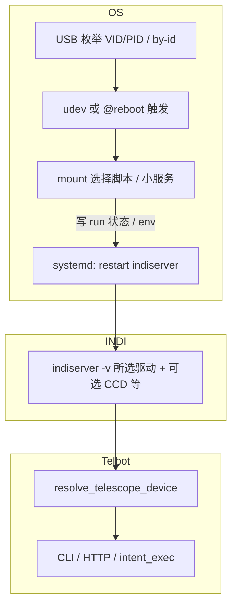

# Telbot 智能盒子：多品牌望远镜 — 实现计划（Agent 用）

## 0. 目标与约束

- **目标**：USB 接入后，系统能根据设备身份选择并启动对应 **INDI 望远镜驱动**；**换镜可重启 `indiserver`**；Telbot 自动解析 **`TELBOT_INDI_DEVICE`**（或等价机制），用户无需手改 `.env` 里的设备名/驱动行（高级覆盖仍保留）。
- **约束**：望远镜控制 **只通过 INDI**；不实现各品牌私有协议栈。
- **平台假设**：树莓派类 Linux，`indi-bin` / 各 `indi_*` 包由 apt 或镜像预装；单台物理镜同一时间 **只连一条** 控制链路（串口/USB）。

## 1. 架构（逻辑）

- **OS 层**：根据 **manifest** 决定本次 `ExecStart` 的驱动列表；执行 **`systemctl restart …`**。
- **Telbot 层**：在驱动已加载、`indi_getprop` 可用后，**自动选设备名**（多设备时按串口/属性匹配；单设备则 discover）。

## 2. 交付物清单

| 编号 | 交付物 |
|------|--------|
| D1 | **Manifest**：`deploy/mount_profiles.json` |
| D2 | **脚本**：`deploy/telbot-select-mount.sh` + `deploy/telbot_select_mount.py` |
| D3 | **systemd**：`deploy/indi-telescope.service`、`deploy/telbot-indiserver-wrap.sh` |
| D4 | **udev**：`deploy/99-telbot-mount.rules` |
| D5 | **Telbot**：`TELBOT_INDI_DEVICE_AUTO`、`mount_resolve.py`、CLI/HTTP/intent 入口 |
| D6 | **文档**：`docs/MOUNT_AUTO.md`、`README`（含树莓派联机与语音意图章节）、`日常观测操作指南`（若存在） |
| D7 | **测试**：`tests/test_mount_resolve.py` |

## 3. Manifest schema

每条 **profile**：`id`、`priority`、`match`（`usb_vid_pid` 和/或 `by_id_substring`）、`indi_drivers`、`optional_indi_drivers`、`device_name_hint`（可选）、`packages_suggest`（可选）。

## 4. 系统脚本行为

扫描 `lsusb` 与 `/dev/serial/by-id/*`，按 **priority** 匹配 manifest；无匹配则用 `default_profile_id`。写入 `/run/telbot/indiserver.args`、`indi_device_hint`、`mount_profile_id`；与上次相同则 **不** `systemctl restart`。去抖：`flock /run/telbot/select-mount.lock`。

## 5. Telbot 改动摘要

- `config.py`：`indi_device_auto`（默认 `false`）。
- `mount_resolve.py`：`resolve_telescope_device(s)`；读 `/run/telbot/indi_device_hint`；与 `indi_getprop` 解析的望远镜设备及 `/dev/tty*` 匹配。
- `indi.py`：`discover_telescope_devices()`。
- 替换 `s.indi_device` 为 `resolve_telescope_device(s)`（保留 `--device` 覆盖）。

## 6. 验收与实现顺序

见仓库内已实现的脚本与文档；现场用 `lsusb` 核对 VID:PID 后改 manifest。

## 7. 产品备注

新品牌：manifest 加一行 + apt 装驱动包 + 核对 `lsusb`。换镜会短暂断开 INDI（Ekos 需重连）。**NTP** 仍影响 GOTO/天算。
